<h1 align="center">Simone Siega</h1>

  <strong>Computer Engineering student building developer tools, systems-oriented software, and open-source resources.</strong>

<samp>VENICE, ITALY · <a href="https://www.unipd.it/">UNIVERSITY OF PADUA</a></samp>

  <a href="https://simonesiega.com">Portfolio</a> ·
  <a href="https://www.linkedin.com/in/simonesiega">LinkedIn</a> ·
  <a href="mailto:simonesiega1@gmail.com">Email</a> ·
  <a href="./assets/resume/resume.pdf">Resume</a>

  

## Selected Projects

- **[European Tech Opportunities 2027](https://github.com/simonesiega/european-tech-opportunities-2027)** `live · v1.0.0` – Discover tech internships and new-grad roles across Europe for the 2027 hiring cycle. An automated Python pipeline collects, classifies, and checks listings for a [public directory](https://techopportunities.eu/).
- **[codex-limits](https://github.com/simonesiega/codex-limits)** `stable · v1.3.1` – Monitor OpenAI Codex usage limits, reset times, and reset credits from the terminal. Cross-platform CLI/TUI with JSON output for automation and integrations for OpenCode, pi, and GitHub Copilot CLI. Available on [npm](https://www.npmjs.com/package/@simonesiega/codex-limits) with <!-- codex-downloads:start -->2.8K+ downloads<!-- codex-downloads:end -->.
- **[fluid-simulation](https://github.com/simonesiega/fluid-simulation)** `in development` – Interactive 2D fluid-simulation prototype in C++20, currently focused on CPU density and velocity fields, with OpenGL Compute and CUDA backends planned for reproducible performance comparisons.
- **[cfg-parser](https://github.com/simonesiega/cfg-parser)** – Rust CLI for parsing and evaluating arithmetic expressions using a hand-written recursive-descent parser, supporting operator precedence, implicit multiplication, and roots.

## Open Source Contributions

- **[Supernova](https://github.com/mattiacerutti/supernova)** – Contributed [4 merged PRs](https://github.com/mattiacerutti/supernova/pulls?q=is%3Apr+is%3Amerged+author%3Asimonesiega) to a desktop development environment built around the Pi coding agent, improving Windows title-bar controls, icons, and sidebar behavior.

## Resources & Practice

- **[UNIPD Computer Engineering](https://github.com/simonesiega/unipd-computer-engineering)** – Student-maintained LaTeX collection of lecture notes, exercises, proofs, and diagrams for Computer Engineering at the University of Padua, with reproducible builds and a [website to browse courses and read or download PDFs](https://notes.simonesiega.com/courses.html).
- **[LeetCode Solutions](https://github.com/simonesiega/leetcode-solutions)** `ongoing` – Python solutions following the [NeetCode All roadmap](https://neetcode.io/roadmap) and company-specific interview practice, organized by topic with progress tracking, personal difficulty ratings, and complexity notes.

